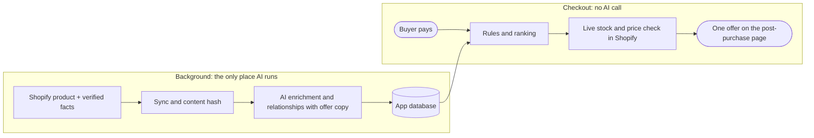

# AI Post-Purchase Upsell (Shopify case study)

After a buyer pays, Shopify can show one more offer before the thank-you page. If the buyer accepts, the product is added to the same order, and Shopify charges only the difference. This app picks that offer: one related product the buyer is likely to want, with a short pitch written from facts the merchant has verified.

The AI work happens in the background. It reads the catalog, works out which products go together and writes the offer copy. At checkout the app makes no AI call. It picks from those stored results with plain rules and a live Shopify stock and price check, which keeps checkout fast and keeps the AI away from prices and stock.

This is a job-interview case study built on a Shopify development store with fictional demo products. It is not an official Grüns storefront or a production deployment.

## Status

| Phase | What | Status |
|---|---|---|
| 1 | Post-purchase extension, signed changeset, hardcoded offer | Done, verified with Bogus Gateway orders (`docs/phase-1-test-checklist.md`) |
| 2 | Catalog sync, AI enrichment and relationships with offer copy, Events, Settings, offer engine, checkout wiring | Done, verified with real test orders #1012-#1016 (`docs/phase-2-test-checklist.md`) |
| 3 | AI selection at checkout | Replaced by the Phase 2 design: copy is written offline and checkout is deterministic (see "Key decisions") |
| 4 | Offer events (shown, accepted, declined, applied) and an Analytics page | Done, verified with real test orders #1017-#1019 (`docs/phase-4-test-checklist.md`) |

## How it works



**AI recommends offline, the backend validates, and Shopify calculates and applies.** The model never decides prices, discounts, stock or what gets charged. For the full pipeline, the checkout sequence and the data model, see [docs/architecture.md](docs/architecture.md).

## Key decisions

- **No AI call at checkout.** Shopify requires post-purchase network calls to finish within 2 seconds ([Shopify UX guidance](https://shopify.dev/docs/apps/build/checkout/product-offers/ux-for-post-purchase-product-offers)). The AI calls took 2.4-5.4 s (measured), while checkout decisions take 209-317 ms (measured on test orders).
- **Copy only from verified facts.** The AI may cite only the merchant's `custom.verified_facts`. If a cited fact is later removed, checkout falls back to template copy.
- **One stored decision per checkout, and only that pick is signed.** The buyer always sees the same offer, and the server rechecks stock before signing, so the browser can't change the product or discount.
- **Least privilege and cost control.** The app needs only `read_products`. An optional upsell tag limits it to chosen products, and a manual AI mode lets the merchant decide when AI cost happens.

The reasoning behind each decision is in [docs/architecture.md](docs/architecture.md#key-decisions).

## Quick start

You need Node.js `>= 22.12`, Shopify CLI 4.x, a Shopify Partner account with a development store, and an OpenAI API key. The full steps, with explanations and troubleshooting, are in **[docs/setup.md](docs/setup.md)**.

```sh
git clone https://github.com/UribeJr/ai-checkout-upsell.git
cd ai-checkout-upsell
npm install
npm run config:link        # link to your own Shopify app (see setup step 2)
cp .env.example .env       # then fill in OPENAI_API_KEY and OPENAI_MODEL
npm run setup              # database

# demo products on your development store (dry run first, then --yes)
shopify store auth --store <your-store>.myshopify.com --scopes write_products,read_publications,write_publications
node scripts/seed-demo-catalog.js --store <your-store>.myshopify.com --yes

shopify app dev
```

Then:
1. Copy the tunnel URL into `extensions/intelligent-offer/src/config.js`.
2. In the app's **Settings**, set the upsell tag to `case-study-demo` and press **Save and sync**.
3. Wait until **Product intelligence** shows all 10 products enriched.
4. Run a test checkout through the dev link, paying with card `1` ([how](docs/setup.md#run-a-test-checkout)).

## Documentation

| Page | Read it to |
|---|---|
| [docs/setup.md](docs/setup.md) | Install, connect your store, seed the demo catalog and run a test checkout |
| [docs/architecture.md](docs/architecture.md) | Understand both pipelines, the checkout rules, the data model, each design decision and the production path |
| [docs/analytics.md](docs/analytics.md) | See what the Analytics page measures and how each number is defined |
| [cost.md](cost.md) | See AI and hosting cost by catalog size, measured or estimated |
| `docs/phase-*-test-checklist.md` | Check test evidence for each phase, including real test orders |

## Testing

```sh
npm test       # 61 unit tests: ranking, validators, token parsing, events, analytics, upsell tag, seed planning
npm run lint
```

End-to-end results come from real test orders on the development store: #1012-#1016 in [phase-2-test-checklist.md](docs/phase-2-test-checklist.md) and #1017-#1019 in [phase-4-test-checklist.md](docs/phase-4-test-checklist.md). They cover accept, decline, a multi-item cart, out-of-stock fallback and an offer refused after it sold out.

## Limitations and future work

- Revenue is attributed, not proven incremental: there's no holdout group yet, and refunds aren't subtracted.
- Outcomes don't feed back into ranking yet. The plan is to blend relationship scores with observed accept rates and revenue.
- Three ranking fixes are planned: a ceiling on the multi-item bonus, a check so a cart isn't offered something a bundle in it already contains, and checking more than the top 8 when all of them fail.
- It runs under `shopify app dev`. A demo without the dev server needs a hosted backend and a real app URL.
- Post-purchase extensions are in beta and need extra access for production, and some payment methods get no post-purchase page.

The details are in [docs/architecture.md](docs/architecture.md#limitations-and-future-work), and what it would take to run this for real merchants is in [Production path](docs/architecture.md#production-path).

## Repo map

```text
app/routes/             admin pages (app.*), checkout endpoints (api.offer, api.sign-changeset, api.offer-events), webhooks
app/services/ai/        provider adapter, OpenAI client, JSON schemas, validators
app/services/catalog/   sync, content hash, upsell tag rules, enrichment, relationships, queue, Events handling
app/services/offers/    ranking rules, offer engine, checkout decisions, changeset payload
app/services/analytics/ offer events and metrics
extensions/intelligent-offer/  post-purchase checkout extension (React)
prisma/                 schema and migrations (SQLite)
scripts/                demo catalog data and the reviewer seed script (not part of the app)
test/                   unit tests (node --test)
docs/                   setup, architecture, analytics, phase plans and test checklists
cost.md                 running cost model
master_context.md       working log: status, decisions, session history
```
