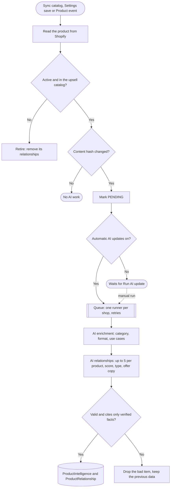
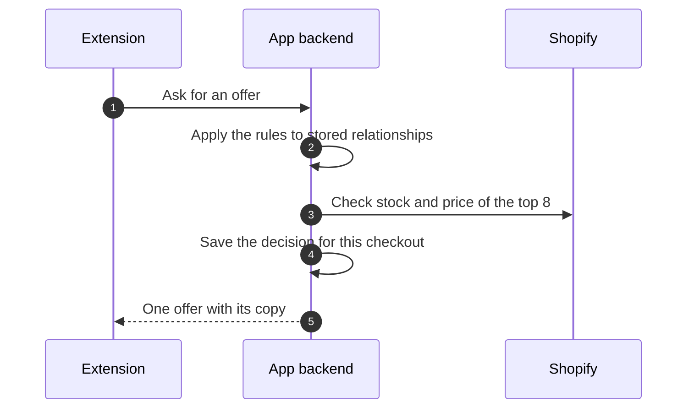
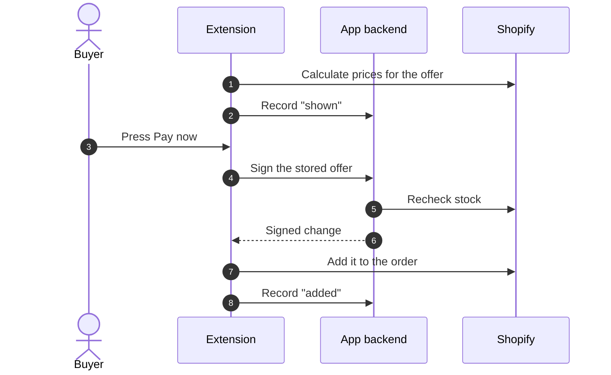
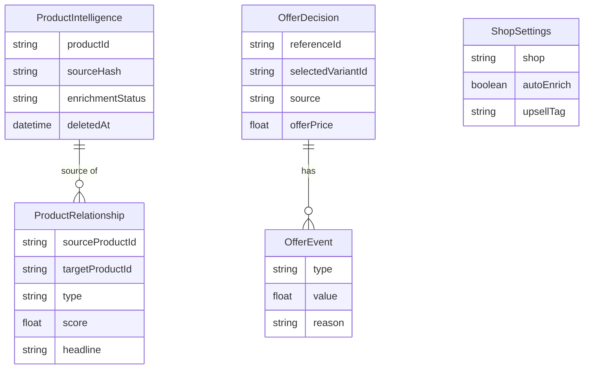

# Architecture

How the app picks and shows a post-purchase offer, and why it's built this way. For setup, see [setup.md](setup.md).

The principle: **AI recommends offline, the backend validates, and Shopify calculates and applies.** The model never decides prices, discounts, stock or what gets charged.

## Background pipeline: where the AI runs

Product data reaches the app three ways: **Sync catalog** on Product intelligence, saving the upsell tag in Settings, and Shopify Product events. The events fire only on content fields, never on price or inventory. A content hash then decides whether the AI has anything new to do.

- **Enrichment** (`app/services/catalog/enrichment.server.js`) gives each product a category, format and use cases.
- **Relationships** (`relationships.server.js`) give each product up to 5 related products. Each relationship has a score, a type (`COMPLEMENTARY`, `ACCESSORY`, `REFILL` or `UPGRADE`) and offer copy. The copy may only use the target product's `custom.verified_facts`.
- **Verified facts** are written by the merchant and are the only facts the AI may quote; see [verified-facts.md](verified-facts.md).
- **Validation** (`app/services/ai/validators.js`) checks every AI result before it is saved: known product IDs, no self-links, facts that really belong to the product, no prices, discounts or health-claim wording in the copy, and length limits. An invalid result is dropped and the previous data is kept.
- **The queue** (`enrichment-queue.server.js`) runs in-process, with one runner per shop and up to 3 attempts with backoff.

## Checkout: no AI call

Checkout has two moments. **While the buyer pays,** the extension asks the backend for an offer, and the backend decides from data the AI prepared earlier. **On the post-purchase page,** the buyer accepts or declines, and the backend signs only the offer it stored.

### 1. While the buyer pays: decide the offer

The extension's `ShouldRender` step calls `/api/offer`.

How the backend decides (`app/services/offers/`):

1. **Basket.** The purchased products, variants and subtotal come from the post-purchase token, which Shopify signs and the backend verifies.
2. **Candidates.** The stored relationships of those products.
3. **Rules.** Drop `UPGRADE` relationships, products already bought and scores below 0.6. When several cart items point at the same product, keep it once with +0.05 per extra item.
4. **Live check.** One Shopify query for the top 8. Keep the first that is active, in stock and priced at or below the order subtotal.
5. **Copy.** Use the stored AI copy only if every fact it cites is still a verified fact. Otherwise use template copy ("Add {product} to your order").
6. **Store.** Save one `OfferDecision` per checkout. If Shopify calls again for the same checkout, the backend reuses it after another live check.

If nothing passes, there is no offer, and the buyer goes straight to the thank-you page.

### 2. On the offer page: accept or decline

- **Prices** on the page come only from Shopify (`calculateChangeset`), never from the backend.
- **Pay now** calls `/api/sign-changeset`. The backend builds the change itself from the stored decision and signs it with the app secret, so the browser can't change the product or discount. Shopify then applies it (`applyChangeset`) and charges only the difference.
- **If the offer sold out** while the page was open, the backend refuses to sign (HTTP 409). Nothing is added, and the buyer goes to the thank-you page.
- **Decline this offer** records "declined" and goes to the thank-you page.
- **Each step** (shown, accepted, added, declined, failed) is recorded through `/api/offer-events` for the Analytics page. See [analytics.md](analytics.md).

## Data model

The full schema is in [`prisma/schema.prisma`](../prisma/schema.prisma). JSON fields are stored as strings so SQLite and Postgres behave the same.

## Key decisions

- **No AI call at checkout.** Shopify requires post-purchase network calls to complete in two seconds or less ([UX for post-purchase product offers](https://shopify.dev/docs/apps/build/checkout/product-offers/ux-for-post-purchase-product-offers)). Offline AI calls took 2.4-5.4 s each (measured), so a live AI call would usually miss that. Writing the copy ahead of time makes the checkout decision fast (209-317 ms measured on real test orders) and free in AI cost.
- **Copy grounded in merchant facts.** The AI may cite only the product's `custom.verified_facts` metafield, which the merchant owns and the app only reads. At checkout, if a fact the copy cites has since been removed, the app uses template copy instead (the stale-fact guard).
- **One stored decision per checkout.** Shopify can call ShouldRender more than once. The first call decides and saves an `OfferDecision`; later calls reuse that pick after a live check, so the buyer always sees the same offer. Checkouts with no offer are saved too.
- **Only the stored pick is signed.** The browser only says which offer was accepted. The server rebuilds the changes from the saved decision and checks stock again, so a buyer can't change the product or discount, and an offer that sold out while the buyer was on the page is refused (409).
- **Prices only from Shopify.** The extension shows only amounts returned by `calculateChangeset`. The discount (15% by default) is a server-side policy.
- **Least privilege.** The app asks only for `read_products`.
- **Content-only triggers.** Events subscribe to title, description, type, tags, status, options and `custom.verified_facts`. Price and inventory edits never start AI work; they are read live at checkout.
- **Upsell catalog by tag.** Settings can limit the app to products with one tag, for example `upsell`. Adding the tag in Admin brings a product in; removing it takes the product out right away, at no AI cost. With no tag, every active product is used. The tag also caps AI cost, which depends on catalog size.
- **Manual AI mode.** Settings can turn automatic AI updates off. Changes still queue up, and the merchant runs them when they choose, which also controls cost.

## Admin pages

- **Product intelligence:** sync status, AI profiles and relationships for each product, plus the queue controls.
- **Offer preview:** build a basket and see the offer checkout would choose, every candidate and why each one wasn't chosen. It runs the same decision code as checkout and makes no writes.
- **Settings:** the upsell tag (which products are in the upsell catalog), automatic vs. manual AI updates, waiting and failed counts, and a manual **Run AI update** button.
- **Analytics:** offers shown, conversion, attributed revenue, revenue per offer shown, top offers (with a low-sample warning) and recent checkouts with their events.

## Limitations and future work

- **Revenue is attributed, not proven incremental.** Proving lift needs a holdout group that is never shown an offer. Refunds and cancellations are not subtracted; production would adjust revenue from order webhooks (needs `read_orders`). Analytics reads up to the last 500 decisions with no date filter.
- **Learning from outcomes is not built.** Logged outcomes don't change rankings yet. The plan is to blend relationship scores with observed accept rates and revenue per impression, with sample-size guards, then try experiments.
- **Ranking follow-ups:**
  - The multi-item bonus has no ceiling, which matters in large carts. A cap of about +0.15 is planned.
  - A cart item can be offered something a bundle in the same cart already contains. Test order #1014 is an example.
  - Only the top 8 candidates are checked live. If all 8 fail, no offer is shown.
- **Dev setup:** the tunnel URL must be copied into the extension config on every dev run. The deployed app config still has the scaffold's placeholder `application_url`, so a hosted backend is needed before a demo outside `shopify app dev`.
- **Shopify platform limits:** post-purchase extensions are in beta and need extra access for production. There is no post-purchase page for some payment methods and order types. Third-party pixels see only the initial purchase.
- **Queue:** the background job queue is in-process, with one runner per shop and retries. Production would use a real job queue and a hosted database.

## Production path

None of this is built. These are the changes that would turn the case study into an app real merchants could install, ordered by what blocks a launch first. The design doesn't need to change: the same background pipeline and checkout decision run on sturdier infrastructure, with better data feeding back in.

### 1. Run it for real

| Area | Today | In production |
|---|---|---|
| Backend | Runs under `shopify app dev`, through a tunnel that changes on every run | A hosted backend with a fixed URL in `shopify.app.toml` and the extension's `APP_URL` |
| Database | SQLite file | Postgres. JSON fields are already stored as strings, so the schema moves over as is |
| Background jobs | In-process queue, one runner per shop (`enrichment-queue.server.js`) | A real job queue (for example SQS or BullMQ) running the same steps per job |
| Event deduplication | Handled delivery IDs kept in memory | Stored, so duplicates are caught across restarts and instances |
| Post-purchase access | Works on development stores | The merchant must be on **Shopify Plus**: only Plus stores can install custom apps that use post-purchase extensions. Shopify must also approve access for the live store (review up to 7 days) |

### 2. Trustworthy numbers

- **Refund-adjusted revenue.** Subtract refunds and cancellations using order webhooks. That needs the `read_orders` scope, and order data falls under Shopify's protected customer data requirements.
- **Proven lift.** Hold out a share of checkouts that never see an offer, and compare them with the rest. Today's revenue is attributed, not proven incremental.
- **Analytics at scale.** Aggregate in SQL by date range. Today the page reads the last 500 decisions with no date filter.
- **Real AI cost.** Log the token usage of every AI call instead of estimating it ([cost.md](../cost.md)).

### 3. Better offers over time

- **Ship the three ranking fixes:**
  - a ceiling on the multi-item bonus
  - no offers for products a bundle in the cart already contains
  - checking past the top 8 when they all fail
- **Learn from outcomes.** Blend each relationship's AI score with its observed accept rate and revenue per offer shown. Guard against small samples, then move to controlled experiments or a contextual bandit. Nothing learns from outcomes today.

### 4. Cost at catalog scale

The relationship rebuild is the cost that grows with catalog size², about $10 per run at 1,000 products (estimate). The levers, with estimates from [cost.md](../cost.md):

| Lever | Effect (estimate) |
|---|---|
| Rebuild only the changed product and the products that point at it | A 1,000-product edit: $10.25 to about $0.06 |
| Send the AI a shortlist of about 20 likely matches, not the whole catalog | About $0.003 per edit at any catalog size |
| Prompt caching for the shared catalog part of each call | Up to about 90% off rebuild input |
| Batch API for nightly full rebuilds | About 50% off |

Checkout cost doesn't change at any scale: it makes no AI call.

For the full monthly cost of running this for one merchant (hosting, database and AI at three catalog and order sizes), see [cost.md section 9](../cost.md#9-production-cost-one-merchant-estimates).
